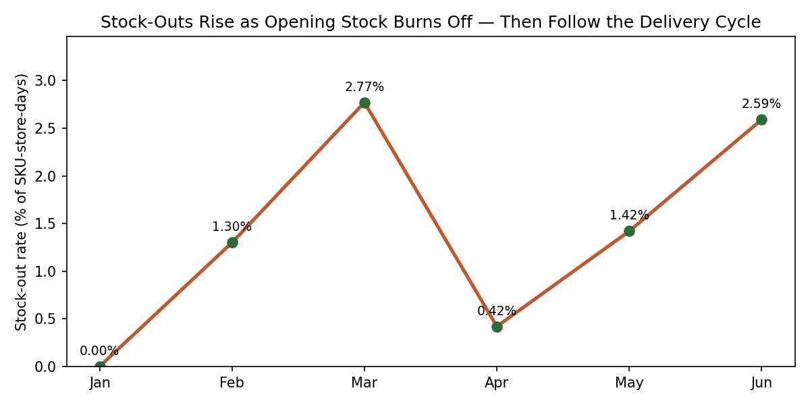
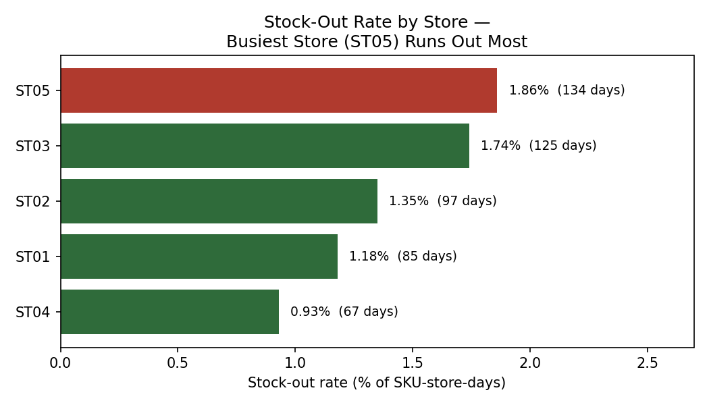
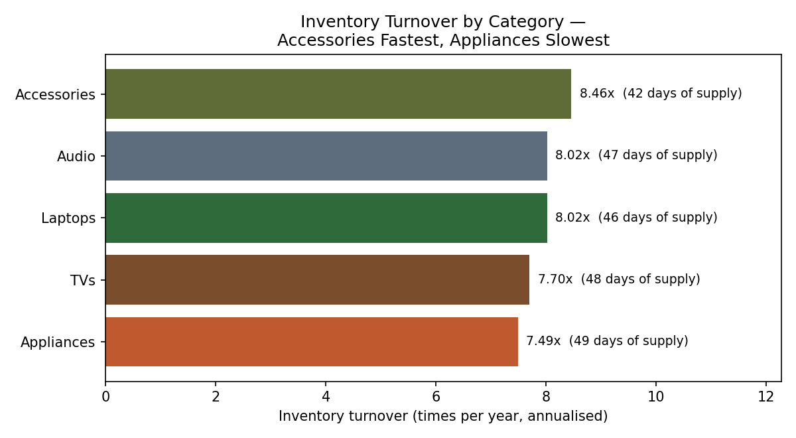
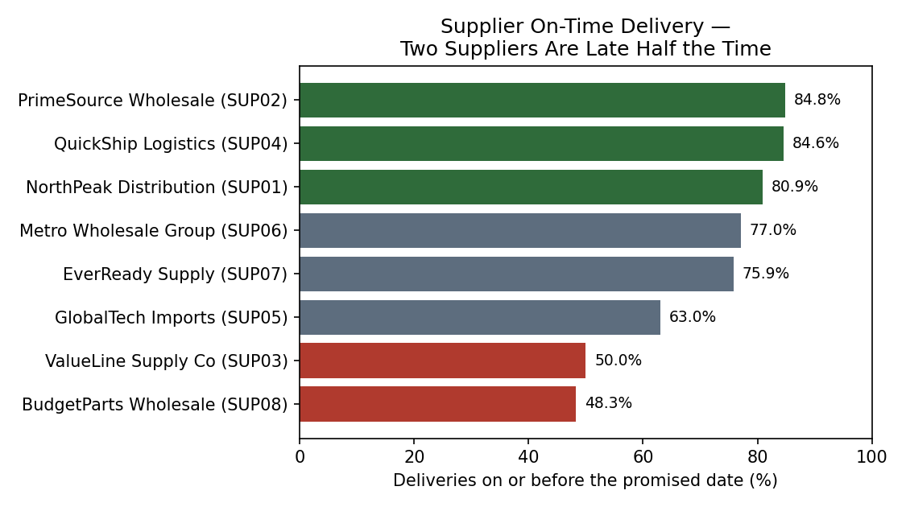
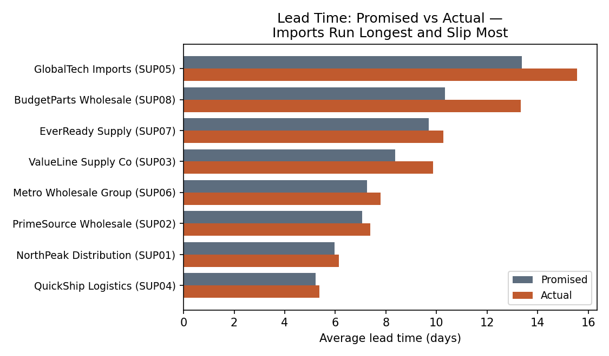
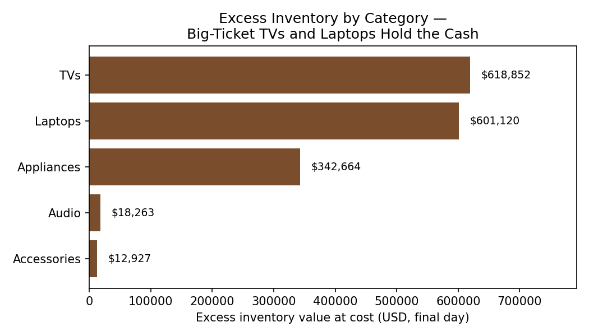

# Inventory & Supply Chain: Stock-Outs, Turnover and Supplier Lead Times

## In simple words — what is this project?

This project is the inventory side of my Best Buy business intelligence analyst job, done as one project.

A shop makes money only when the product is on the shelf. If the shelf is empty, the customer leaves and the sale is lost. If the shop orders too much, cash sits in a stockroom instead of the bank. This project checks both problems at once.

I took shop stock data — 40 products, 5 stores, 180 days, 383 orders sent to 8 suppliers — and answered four questions: How often were shelves empty, and what did that cost? How fast does the stock sell through? Which suppliers deliver late? And how much money is stuck in stock that is not moving?

Main answer: the shelves were full 98.59% of the time, which sounds fine — but the empty days landed on the fast-selling, expensive products and cost an estimated **$1,086,953 in lost sales**. At the same time **$1,593,826 of excess stock** sat in the stockroom. Both problems trace back to one setting: reorder points (the stock level that triggers a new order) were worked out from category averages instead of each product's own sales.

**Four words used everywhere below, in simple language:**
- **Inventory turnover** — how many times a year the stock sells and is replaced. Higher means money comes back faster. Here: 7.85 times a year.
- **Days of supply** — how many days the stock on hand will last at the current sales rate. Here: 45.4 days on average.
- **Lead time** — the days between placing an order and the delivery arriving. Suppliers promise one number; this project measures the real one.
- **In-stock rate** — out of every 100 product-store-days, how many the product was on the shelf and buyable. Here: 98.59 out of 100.

Tools used: SQL, Excel, Tableau, Python — the same tools from my 90-day study plan.

      

> **Portfolio project — synthetic data only.** This repo reproduces the day-to-day work of a **retail inventory / supply chain analytics team** (the Best Buy type of role): availability reporting, replenishment analysis, supplier scorecards and excess-stock reviews. All data is generated with a fixed seed (**42**), so every number below reproduces exactly. No real company data is used, and this is not paid work experience.

## The business problem

A retailer's inventory is usually its biggest pile of cash. Two opposite mistakes burn money at the same time: **stock-outs** (the shelf is empty, the sale walks out of the door) and **excess stock** (money locked in products that sit still while newer models arrive). Both are usually symptoms of the same causes — reorder settings that don't match real demand, and suppliers whose real delivery performance nobody has measured.

This project measures all of it on 180 days of simulated operations: 40 SKUs × 5 stores = 36,000 SKU-store-days, 88,804 units sold, $40,672,164 of revenue, and 383 purchase orders across 8 suppliers with very different reliability.

## Headline KPIs (actual outputs from running this repo)

| KPI | Value |
|---|---|
| Scope | 40 SKUs · 5 stores · 8 suppliers · 180 days (36,000 SKU-store-days) |
| Units sold / Revenue | 88,804 / $40,672,164 |
| **In-stock rate** | **98.59%** |
| Stock-out rate | **1.41%** — 508 full empty-shelf days |
| **Estimated lost sales** | **$1,086,953** (~1,610 units, ≈2.7% of revenue) |
| **Inventory turnover** | 3.87x in 180 days = **7.85x annualised** |
| Average days of supply | **45.4 days** |
| Average inventory value | $5,579,076 |
| Purchase orders | 383 (360 received, 23 still in transit) |
| **On-time delivery** | **71.94%** (101 of 360 received orders were late) |
| Lead time — promised vs actual | 8.55 days vs **9.56 days** |
| Average days late (late orders) | **3.70 days** |
| **Excess inventory (final day)** | **$1,593,826** — 3,641 units above a 60-day supply |

## Dashboard








## Key insights

- **The headline in-stock rate hides real money.** 98.59% sounds healthy, but the 508 empty-shelf days concentrate in fast-selling, high-price SKUs, so they cost an estimated $1,086,953 — about 2.7% of the period's revenue. An average is the wrong place to stop; the worst SKUs are the story.
- **One product lost a fortune:** SKU003 (TV Model 3) was empty 79 of 900 SKU-store-days (8.78%) — an estimated $296,601 of lost sales from a single SKU. The top three stock-out SKUs are all supplied by GlobalTech Imports (SUP05), whose lead times are the longest in the chain (13.38 days promised, 15.56 actual).
- **The busiest store runs out most.** ST05 (Denver, the highest-demand store) has the worst stock-out rate at 1.86%; the quietest store (ST01) is at 1.18%. Same reorder points, different demand — the settings, not the stores, are the problem.
- **Two suppliers are late half the time.** BudgetParts Wholesale (SUP08) delivered on time only 48.28% of the time, averaged 5.80 days late, and shipped short quantities (95.79% fill). ValueLine Supply Co (SUP03) managed 50.00% on-time. The best suppliers (PrimeSource 84.85%, QuickShip 84.62%) prove the standard is achievable.
- **Excess cash sits in big-ticket stock.** Of the $1,593,826 excess, TVs hold $618,852 and Laptops $601,120 — one excess TV ties up as much cash as a shelf of accessories, and electronics lose value as new models launch.
- **Root cause: a settings problem, not a people problem.** Reorder points are calculated from category-average demand. Fast SKUs get too little cover and run out while a late delivery is in transit; slow SKUs get far too much and pile up. Setting reorder points per SKU-store, from its own demand and its supplier's real lead time, attacks stock-outs and excess with one fix.

## How the measures are defined (no hidden maths)

| Measure | Definition used in this repo |
|---|---|
| Stock-out day | A SKU-store-day with zero units available (on_hand_start + units_received = 0) — the shelf was empty all day. In-stock rate = 100 − stock-out rate. |
| Inventory turnover | COGS ÷ average inventory value (average of the daily end-of-day inventory values). Annualised × 365/180. |
| Days of supply | Average units on hand ÷ average daily units sold. |
| On-time delivery | received_date on or before promised_date, over received orders only (23 orders still in transit are counted separately, never silently dropped). |
| Average days late | Mean lateness over **late orders only** — averaging over all orders would bury the problem. |
| Excess inventory | On the final day, units above 60 × that SKU-store's average daily units sold, valued at unit cost. The 60-day threshold is stated so anyone can re-run it with their own. |
| Estimated lost sales | Each stock-out day × that SKU-store's average daily units sold (on in-stock days) × unit price. Counts only full empty days, so it **understates** the true loss — days the shelf emptied mid-day are ignored. |

## Repository structure

```
retail-inventory-supply-chain-analytics/
├── README.md                  ← you are here
├── analysis.py                ← KPI engine: availability, turnover, suppliers
├── charts.py                  ← 6 matplotlib charts
├── requirements.txt
├── LICENSE  ·  .gitignore
├── data/                      ← products, stores, suppliers,
│                                daily_inventory (36,000 rows), purchase_orders
├── sql/analysis_queries.sql   ← 10 commented SQL queries
├── outputs/                   ← kpi_summary.csv, turnover_by_category.csv,
│                                supplier_performance.csv, stockouts_by_store.csv,
│                                top_stockout_skus.csv, monthly_stockout_trend.csv,
│                                excess_by_category.csv, insights.md
├── images/                    ← 6 chart PNGs (embedded above)
├── dashboard/                 ← dashboard.html (live)
└── data_dictionary.md
```

## How to run

```bash
pip install -r requirements.txt
python3 analysis.py          # writes outputs/*.csv + outputs/insights.md
python3 charts.py            # writes images/*.png
```

Then open `dashboard/dashboard.html` in a browser.

## SQL highlights (`sql/analysis_queries.sql`)

10 commented queries including: the overall in-stock rate, stock-outs by store and by month, **turnover by category built from a daily-totals CTE**, the full supplier scorecard (promised vs actual lead time with `julianday` differences, on-time %, quantity fill %), a lateness distribution, and the two CTE-heavy estimates — **excess inventory on the final day** and **lost sales from empty shelves** — which reproduce the Python results to the cent ($1,086,952.52).

## Interview Q&A

**Q1. Your in-stock rate is 98.59% — isn't that good enough?**
It's the average that misleads. The 1.41% of empty days are not spread evenly: they land on fast-selling, expensive SKUs — one TV model alone was out 8.78% of days and cost an estimated $296,601. I report the chain average for the headline and the worst SKUs for the action, because that's where the money is.

**Q2. How did you estimate lost sales — and why should I trust the number?**
For every stock-out day I multiplied the SKU's average daily sales at that store (measured on days it was in stock) by its price, and summed: $1,086,953. You should trust it as a floor, not an exact figure — I say so in the repo. It counts only days the shelf was empty all day; a shelf that emptied at noon still lost the afternoon's sales, and those aren't counted, so the true loss is higher.

**Q3. What is inventory turnover, and is 7.85 good?**
Turnover is COGS divided by average inventory value — how many times a year the stock sells through and the cash comes back. For consumer electronics, roughly 5–9x is a normal working range, so 7.85x is healthy overall — but the spread matters: Accessories turn at 8.46x while Appliances crawl at 7.49x with 49 days of supply.

**Q4. What went wrong with the reorder points?**
They were set from category-average demand — one number for every product in a category. A fast seller burns through that cover long before a delivery arrives, especially when the supplier is late; a slow seller never burns through it and the stock piles up. It's one formula causing both headline problems, which is why my first recommendation is per-SKU-store reorder points based on each product's own demand and its supplier's measured lead time.

**Q5. Which supplier would you confront first, and with what evidence?**
BudgetParts Wholesale (SUP08): 48.28% on-time, 5.80 days late on average when late, and a 95.79% quantity fill — they also ship short. But GlobalTech Imports (SUP05) is the bigger conversation: it carries the most orders (73) and supplies the three worst stock-out SKUs, with a 15.56-day actual lead time against 13.38 promised. I'd take SUP05's scorecard and the SKU003 lost-sales figure into that meeting.

**Q6. Why is excess inventory a problem if the products eventually sell?**
Three reasons: the cash is trapped ($1,593,826 above a 60-day supply could be in the bank), storage and handling cost money, and electronics specifically lose value — last year's TV model sells at a discount when the new one launches. "Eventually sells" often means "eventually sells for less."

**Q7. What would you do next with real data?**
Add demand during lead time and safety-stock calculations per SKU-store, track on-shelf availability from POS scan data instead of end-of-day snapshots, put the supplier scorecard on a monthly cadence with OTIF (on time in full) as the headline, and forecast demand for the top 20 SKUs so reorder points update with trends instead of sitting fixed.

## 30-second talk track

"Retailers lose money two opposite ways: empty shelves and stockrooms full of the wrong products. In this project I analysed 180 days of stock movements for 40 products in 5 stores — 36,000 product-store-days and 383 supplier orders. The headline in-stock rate was 98.59%, but the empty days sat on the fast-selling expensive products and cost an estimated $1.09 million in lost sales, while $1.59 million of excess stock sat idle. I traced both problems to reorder points set from category averages, and to two suppliers who deliver late half the time. Turnover was 7.85 times a year with 45 days of supply. The SQL, Python, charts, tests and dashboard are all in the repo, and every number reproduces from a fixed seed."

## Honest limitations

- **Lost sales are an estimate with a stated method**, not a measurement — see Q2. Any analyst who gives you an exact lost-sales figure is inventing it.
- **"Excess" depends on the 60-day threshold.** A retailer with a different model cycle would pick a different number; the method is transparent so the threshold can be changed and re-run.
- **End-of-day snapshots** miss intra-day stock-outs (a shelf empty from noon still shows units sold that day). Real on-shelf availability uses scan or audit data.
- The data is **simulated** — demand, supplier reliability and starting stock are planted with a fixed seed to mirror a real electronics retailer. The analysis methods are identical to the ones used on real data; no real company data appears anywhere in this repo.

## Disclaimer

